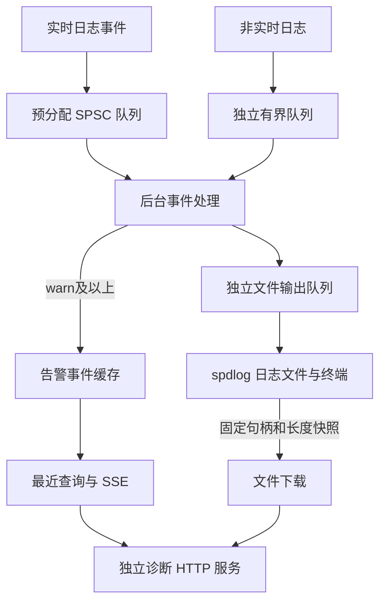

# ROCOS-App 日志系统修改计划

- 编写日期：2026-10-22
- 状态：设计与修改计划，尚未实施
- 范围：日志统一入口、本地存储、告警推送、最近记录查询、最新文件下载及验证
- 本文是仓库内的实现设计说明，不是持续维护的本地 OpenAPI 副本；API 协议以 Apifox 为维护源。

## 1. 当前状态与目标

### 1.1 当前状态

当前使用 spdlog 输出到日志文件和终端，默认记录 `info` 及以上级别。`debug`、`trace` 默认被过滤，部分 `cout/cerr` 没有进入文件日志。

当前尚未实现以下功能：

- `warn/error/critical` 实时推送上位机。
- 最近告警日志查询与断线补取。
- 最新日志文件下载。
- 本文提出的实时事件入口、独立诊断服务和存储管理规则。

现有实现主要位于 [logger.cpp](../src/logger.cpp) 和 [logger.hpp](../src/logger.hpp)。现有日志目录依赖进程工作目录，使用每日轮换，没有配置文件大小和历史保留数量上限。

### 1.2 目标行为

| 通道 | 内容 | 用途 |
| --- | --- | --- |
| 本地日志文件 | 所有通过文件级别配置的日志，默认 `info` 及以上 | 完整排障记录 |
| SSE 实时推送 | 固定为 `warn/error/critical` | 上位机及时告警 |
| 最近日志查询 | 缓存中的 `warn/error/critical` | 初次加载、断线补取 |
| 最新文件下载 | 最新日志文件内的全部记录 | 上位机保存和分析 |

“全部日志”指通过配置门槛、成功进入日志系统的记录。若需要保存全部六种级别，可将文件门槛设为 `trace`；实时推送门槛仍固定为 `warn`。

有界、非阻塞设计无法承诺无限负载下零丢失。必须记录拥塞、丢弃和历史缺口，关键故障还应保留在运动结果或故障状态中。

## 2. 整体架构与实时性边界



### 2.1 实时生产端

建立统一的 `LogManager`，分别提供实时事件入口和非实时日志入口。

- 每个已知实时生产线程使用独立、预分配的 SPSC 环形队列。
- 实时端只复制固定大小记录，例如事件类型、级别、错误码、模块编号、关节索引、周期编号和必要数值。
- 时间使用控制周期已有的基准，由后台转换为日历时间。
- 不使用 `std::string` 动态拼接、JSON 序列化、动态内存分配、文件或网络 I/O。
- 不进行系统调用，不等待互斥锁或自旋锁，不为补充日志而读取硬件或获取机器人控制锁。
- 入队满时立即返回失败并更新丢弃计数，禁止循环等待或回退到同步打印。
- 按值复制事件，不传递栈上字符串或临时对象的裸指针。
- 检查目标平台的原子操作是否真正无锁；用实测验证写入耗时上界，不能仅凭“无锁”认定满足实时要求。

### 2.2 后台处理与通道隔离

- 非实时线程使用独立的有界入口，允许普通日志格式化。
- 后台事件线程生成可读英文和 SSE JSON；同一事件尽量只序列化一次。
- 文件输出使用独立有界队列。文件写入阻塞时，事件处理线程不得等待文件线程。
- 每个 SSE 客户端使用独立有界发送缓存，网络发送在连接会话中完成。
- 网络写入前释放公共缓存锁；慢客户端不能阻塞生产端、文件输出或其他订阅者。
- 关键控制路径迁移到实时事件入口；仅在现有 spdlog 后增加一个 SSE sink，不能消除调用点格式化和异步队列阻塞。

### 2.3 实例与生命周期

- 整理日志实例管理，避免按模块名称重复创建，保证初始化并发安全。
- 解析启动配置后，在初始化 Robot、Hardware 和 Model 前建立日志系统。
- 配置解析等早期失败保留非实时的终端后备输出。
- 退出时协调停止订阅、释放下载句柄和后台日志处理；不让等待中的 SSE 会话阻碍正常退出。

## 3. 日志内容与呈现

### 3.1 错误说明

保留现有错误码数值，补全错误名称映射。关键错误应准确区分指令、反馈、规划和执行阶段，并包含必要的对象、数值和单位。

英文示例：

```text
Joint 2 command velocity exceeded the limit: 1.800 rad/s; maximum allowed: 1.500 rad/s.
```

- `code` 用于程序判断，`message` 用于直接阅读，客户端不解析英文句子。
- “已停止”“已恢复”等结论，必须在实际确认后记录。
- 错误级别与错误码独立；普通警告没有对应业务码时允许 `code` 为空。
- 底层事件仍记录生成说明所需的数值，HTTP 响应不额外提供 `motion_id/context`。
- 整理现有 Robot、Executor、Controller、Model、Hardware、Lua 和启动流程中的零散打印。

### 3.2 上位机日志记录

```json
{
  "id": "session-a:1842",
  "timestamp": "2026-10-22T15:30:20.123+08:00",
  "level": "error",
  "module": "PositionController",
  "code": -2310,
  "message": "Joint 2 command velocity exceeded the limit: 1.800 rad/s; maximum allowed: 1.500 rad/s."
}
```

| 字段 | 类型 | 约定 |
| --- | --- | --- |
| `id` | string | 启动会话 ID 与递增序号，用于补取和去重 |
| `timestamp` | string | 实际发生时间；RFC 3339，包含毫秒和时区 |
| `level` | string | 仅 `warn`、`error`、`critical` |
| `module` | string | 来源模块名称 |
| `code` | integer 或 null | 原始错误码，没有对应码时为空 |
| `message` | string | 可直接显示的完整英文说明 |

上述字段均返回。文件与 SSE 中的同一告警应能够通过事件 ID 对应。

### 3.3 示教器分层展示

| 层级 | 展示方式 | 内容 |
| --- | --- | --- |
| 一级 | 顶栏横幅或 Toast | 严重程度图标与简短说明 |
| 二级 | 点击展开详情 | 完整英文说明、发生时间、模块和错误码 |
| 三级 | 诊断页面与文件导出 | 相关记录和完整日志文件 |

前端不直接堆砌原始 JSON。重复事件可以更新次数，避免连续弹出提示；关键故障状态不能仅依赖某条 SSE 日志是否送达。

## 4. 文件存储与配置

建议增加以下启动配置，数值为初始设计值，后续通过测试确认：

```yaml
logging:
  directory: ../logs
  file_level: info
  console_level: info
  max_file_size_mib: 50
  max_files: 20
  flush_interval_ms: 1000

diagnostics:
  host: "0.0.0.0"
  port: 8082
  max_sse_clients: 4
  max_downloads: 1
```

### 4.1 路径与轮换

- 相对目录以启动 YAML 所在目录为基准解析，不依赖进程工作目录。
- 使用 `.log` 扩展名，例如 `rocos-app_2026-10-22_153020_001.log`。
- 达到 50 MiB 或跨日时创建新文件；文件名避免冲突及原地截断复用。
- 最多保留 20 个文件，包含当前文件，名义容量约 1 GiB。
- 文件创建、扫描、轮换和清理由后台日志存储模块完成。
- 下载中的文件受到生命周期保护；清理逻辑与正在使用的读取句柄协调。

### 4.2 级别与刷新

- 文件默认 `info`，可按需要开启 `debug/trace`；文件策略应保留告警级记录。
- 文件、终端级别独立；终端门槛不影响告警事件发布。
- SSE 与最近告警查询固定为 `warn` 及以上，不提供降低门槛的参数。
- 普通日志按后台周期刷新；重要错误请求尽快刷新，不在控制线程等待。
- 缓冲刷新与断电持久化不是同一保证，不将普通 flush 描述为已经执行磁盘同步。

## 5. 拟新增 HTTP 接口

三个接口统一由独立诊断服务提供，建议端口为 `8082`；控制服务保留原有端口。诊断服务拥有独立的 cpp-httplib 实例和工作线程池。

| 方法与路径 | 成功媒体类型 | 用途 |
| --- | --- | --- |
| `GET /api/logs` | `application/json` | 最近告警查询与补取 |
| `GET /api/logs/stream` | `text/event-stream` | 实时告警订阅 |
| `GET /api/logs/file/latest` | `text/plain; charset=utf-8` | 最新日志文件下载 |

这些接口均为只读，不申请、占用或续期机器人控制权。接入权限与部署策略在协议同步时一并确认，不能把独占控制权作为日志订阅资格。

### 5.1 最近告警查询

```http
GET /api/logs?limit=100
GET /api/logs?after=session-a:1842&limit=100
```

- `limit` 默认 `100`，范围 `1～500`。
- 未指定 `after` 时返回最近的记录；指定后，从该 ID 之后分页返回。
- 数组始终按事件序号升序排列。
- 游标格式错误、同一会话的游标超出当前最新值时返回参数错误。

响应示例：

```json
{
  "success": true,
  "code": 0,
  "message": "ok",
  "data": {
    "events": [],
    "next_id": "session-a:1842",
    "has_more": false,
    "gap": null
  }
}
```

`next_id` 用于下一次查询或订阅；有记录时为最后一条 ID。首次查询且缓存为空时返回当前会话零号游标，例如 `session-a:0`。发生历史缺口时，`gap` 返回原因和最早可用 ID。

外层 `code` 表示查询结果，事件内的 `code` 表示日志涉及的错误原因。

### 5.2 SSE 实时订阅

```http
GET /api/logs/stream
GET /api/logs/stream?after=session-a:1842
```

- 支持查询参数 `after` 和请求头 `Last-Event-ID`；后者优先。
- 没有游标时只订阅新事件；有游标时先补发缓存，再转为持续订阅。
- 每条日志发送 `event: log`，SSE `id` 与正文记录 ID 一致。
- 每 15 秒发送注释形式的心跳，不生成日志记录。
- 缓存缺失、服务重启或生产队列溢出时发送 `event: gap`；缺口事件不设置 SSE `id`。
- 支持的缺口原因包括 `buffer_overrun`、`server_restarted`、`producer_overflow`；已知丢弃数量时附带计数。

成功响应头包括：

```http
Content-Type: text/event-stream
Cache-Control: no-cache
X-Accel-Buffering: no
X-Rocos-SSE-Limit: 4
```

最多 4 个订阅连接。超限返回普通 JSON 错误，HTTP 状态为 `429`，并返回 `Retry-After: 5`。配额需原子预占，并在断开、失败及关闭时可靠释放。第一版采用拒绝新连接，不因长时间没有告警而驱逐旧连接。

### 5.3 最新日志文件下载

```http
GET /api/logs/file/latest
```

请求不接受文件系统路径，由日志存储模块确定最新文件。下载对象是最新的一段文件，不是所有历史文件的压缩包；正文包含该文件的全部级别，不经过 `warn` 筛选。

成功响应示例：

```http
HTTP/1.1 200 OK
Content-Type: text/plain; charset=utf-8
Content-Disposition: attachment; filename="rocos-app_2026-10-22_153020_001.log"
Content-Length: 1258291
Cache-Control: no-store
X-Rocos-Log-Snapshot-Time: 2026-10-22T15:35:00.123+08:00
```

#### 快照与发送流程

1. 文件线程完成当前条目并刷新文件。
2. 固定文件读取句柄与快照字节数。
3. HTTP 会话以固定大小的数据块读取和发送，不把整个文件加载进内存。
4. 后续日志继续写入，但不追加到本次响应中。
5. 即使发生轮换，本次请求仍读取原句柄，直到固定长度发送完成。

快照包含切点时已写入的完整记录，不承诺包含尚在上游排队的事件。不能等待所有日志队列彻底清空，也不能在网络发送期间持有文件写入锁。

文件快照准备需要超时机制；超时返回 `503`。最新文件的选择、文件名和快照大小由同一次存储操作确定，不通过扫描目录的修改时间猜测。

#### 错误与并发

| HTTP 状态 | 场景 |
| --- | --- |
| `404` | 暂无可下载文件 |
| `429` | 超过下载并发上限，初值为 1 |
| `503` | 文件快照暂不可用或准备超时 |
| `500` | 响应正文开始前发现文件读取错误 |

失败时返回普通 JSON。文件正文已经开始发送后发生错误，则终止连接，不向文件正文拼接 JSON；客户端通过实际长度与 `Content-Length` 不一致识别失败。

配置写超时，确保断开与失败后释放读取句柄和下载配额。跨域访问时暴露 `Content-Disposition`、`X-Rocos-Log-Snapshot-Time` 等需要读取的响应头。

### 5.4 查询与订阅错误

| HTTP 状态 | 场景 | 业务码建议 |
| --- | --- | --- |
| `400` | 参数或游标非法 | 现有 `1001` |
| `429` | SSE 或下载配额已满 | 复用 `ResourceUnavailable=-3001` |
| `503` | 诊断服务未就绪或资源暂不可用 | 复用 `ResourceUnavailable=-3001` |

其余文件错误的业务码在协议同步时核对现有定义，不引入另一套未经确认的码值。SSE 在开始流式响应前返回准入错误；响应建立后通过事件或连接关闭处理。

## 6. 容量、背压与资源限制

| 项目 | 初始设计值或规则 |
| --- | --- |
| 告警历史缓存 | 最多 4096 条且最多 16 MiB，任一上限达到即淘汰旧记录 |
| 单条对外事件 | 最大 8 KiB，超长内容明确标记截断 |
| SSE 连接 | 最多 4 个 |
| 同时下载 | 最多 1 个 |
| 网络发送 | 各连接独立有界缓存与写超时 |
| 实时生产队列 | 启动时预分配；容量依据目标事件突发量测试确定 |

记录实时入口丢弃、文件队列丢弃、缓存淘汰和客户端缺口等指标。不能通过打印一条同等级错误反复报告日志系统自身的失败，避免递归和告警风暴。

诊断线程池需要在 SSE 和下载达到上限时，仍有能力处理普通查询与拒绝新请求。独立服务隔离工作线程和请求队列，但仍共享进程 CPU、内存与磁盘资源，须进行压力验证。

## 7. 修改阶段与模块范围

| 阶段 | 修改范围 | 交付结果 |
| --- | --- | --- |
| 第一阶段 | `logger.*`、新增事件与队列模块 | 统一入口、实时事件记录、后台英文格式化、实例管理 |
| 第二阶段 | 新增日志存储模块、`app_config.hpp`、`config/config.yaml`、启动入口 | 固定目录、分级、轮换、清理、刷新与快照 |
| 第三阶段 | 新增诊断 HTTP 服务 | 最近查询、SSE、最新文件下载 |
| 第四阶段 | Robot、Executor、Controller、Model、Hardware、Lua 等调用点 | 关键路径迁移、准确英文、原始错误码与零散输出整理 |
| 第五阶段 | CMake、测试、接入说明与 Apifox | 构建验证、回归与协议回读核验 |

按阶段完成验证；未迁移的旧调用点不能宣称已经满足实时入口约束。保留现有机器人运动行为，不顺带重编号所有错误码。

## 8. 验收计划

### 8.1 功能与协议

- 文件、终端门槛独立；实时接口不包含 `info/debug/trace`。
- 告警字段完整，英文准确，数值和单位与实际检测条件一致。
- 同一告警在文件与 SSE 中可对应。
- 文件大小与跨日轮换、历史清理满足配置。
- 查询分页、游标、SSE 顺序、去重、补发、心跳与缺口通知正确。
- 第 5 个 SSE 连接、第 2 个下载被拒绝，配额在断开后恢复。
- 下载文件名、正文与固定长度一致；空文件也能正确处理。
- 下载中继续写入、轮换和清理，快照仍完整且不混入后续数据。
- 流建立前后错误分别使用正确的 JSON、SSE 或连接终止行为。

### 8.2 实时性与故障隔离

- 检查实时入口没有动态内存分配、系统调用和等待型锁。
- 在目标硬件测量单次入队最大耗时与控制周期抖动。
- 队列满时实时端立即返回，丢弃可被观察。
- 磁盘满、文件写入阻塞、网络断开与多个慢客户端不能回溯阻塞控制线程。
- 慢下载不影响正常文件写入和其他告警订阅。
- 验证连接关闭、服务退出、快照超时和读取句柄释放。

正常局域网下，可先以告警推送延迟 P95 小于 100 ms 为验证目标；该指标不是硬实时保证，最终结论以目标环境实测为准。

单元和 HTTP 测试使用独立日志设施，不连接或使能真实机器人。控制周期指标在明确准备好的模拟器或硬件环境中单独测量。

## 9. Apifox、仓库文档与版本衔接

- 本次设计核对来源为 Apifox 项目 `8387612`，读取到的 API 版本为 `3.0.0`；当前读取索引未列出日志接口。
- 实施同步前重新读取最新协议，并确认模块 `7912103` 和目标分支；当前读取工具未提供可确认的分支标识。
- 按 [rocos-api-maintenance](../.agents/rocos-api-maintenance/SKILL.md) 维护三个新增接口及相关模型。
- 文件下载成功响应必须为原始文本，SSE 必须为事件流，不能误套普通 JSON 封装。
- 当前 Apifox MCP 只支持读取；实际写入使用已授权的可写方式，完成后通过 MCP 刷新、回读验证。
- 不把完整在线协议复制为仓库内持续维护的 OpenAPI 文件。
- 更新必要的接入说明和构建、测试配置。
- 本计划不自动授权 Git 提交、版本递增或发布；创建提交时遵循 [rocos-version-maintenance](../.agents/skills/rocos-version-maintenance/SKILL.md)。

## 10. 实施依据

- [spdlog sinks 与文件轮换](https://github.com/gabime/spdlog/wiki/Sinks)
- [spdlog 异步日志与队列满策略](https://github.com/gabime/spdlog/wiki/Asynchronous-logging)
- [cpp-httplib 阻塞 I/O 与线程池](https://github.com/yhirose/cpp-httplib)
- [cpp-httplib SSE 示例](https://github.com/yhirose/cpp-httplib/blob/master/example/ssesvr.cc)
- [Boost.Lockfree 的保证与限制](https://www.boost.org/doc/libs/latest/doc/html/lockfree.html)
